# HealthScore: A Blockchain-Anchored Healthcare Risk Stratification and Actuarial Pricing Framework

**Arpit Doshi\*, Dhruv Gandhi\*, Harshkumar Padhiyar\*, Hetam Patel\*, Stevina Correia†, Monali Sankhe† and Monika Mangla†**

\*Department of Information Technology, Dwarkadas J. Sanghvi College of Engineering, Mumbai, India
†Department of Information Technology (Professor), Dwarkadas J. Sanghvi College of Engineering, Mumbai, India

---

## Abstract

Rising medical expenditure volatility and opaque underwriting practices create persistent trust deficits between healthcare payers, clinical providers, and insured enrollees. Existing risk-adjustment frameworks often rely on retrospective utilization variables that introduce simultaneous-year target circularity during cold-start enrollment, while executing risk scoring inside centralized black-box silos with no cryptographic auditability. This paper presents **HealthScore**, a two-stage survey-weighted clinical risk stratification and dynamic actuarial pricing framework anchored to a permissioned **Hyperledger Fabric v2.5** blockchain. Using nationally representative adult cohorts across three Agency for Healthcare Research and Quality (AHRQ) Medical Expenditure Panel Survey (MEPS) releases—`HC-251` (2023 Full-Year Consolidated, $N=18,771$), `HC-256` (2024 Full-Year Consolidated, $N=18,979$, including the strictly unseen Panel 29 subcohort of $N=10,037$), and `HC-257` (Panel 28 Two-Year Longitudinal file, $N=8,708$)—we decouple intake-observable cold-start predictors from retrospective utilization proxies. Stage 1 employs a survey-weighted $L_2$-regularized logistic regression classifier to identify high-expenditure patients exceeding the survey-weighted 90th percentile ($\ge \$17,827.41$), achieving a held-out test ROC-AUC of $0.7654$ ($95\%$ CI: $[0.7444, 0.7881]$), PR-AUC of $0.3184$ ($2.66\times$ baseline), and a Weighted Brier Skill Score of $+0.1025$. To address the precision–recall trade-off inherent in skewed population screening, we conduct a rigorous fixed-model probability threshold sensitivity analysis across $\tau \in [0.05, 0.90]$ validated via leak-free 5-fold Out-of-Fold (OOF) cross-validation ($N=15,016$). We demonstrate that while the reference screening threshold ($\tau = 0.10$) maximizes Balanced Accuracy ($0.7122$) with $77.33\%$ recall and $23.18\%$ precision ($1.93\times$ base rate, achieving $77.3\%$ of the $29.98\%$ theoretical oracle precision ceiling at a $39.97\%$ flagged volume), selecting the validation F1-optimal primary threshold ($\tau = 0.20$) increases test precision to $30.49\%$ ($2.54\times$ enrichment; $33.91\%$ on unseen 2024 Panel 29), improves F1-score to $0.3695$, and reduces false positives by $58.3\%$ while retaining $46.89\%$ recall; a targeted cutoff of $\tau = 0.30$ further increases precision to $40.00\%$ ($3.34\times$ enrichment, $94.83\%$ specificity) and cuts false positives by $85.2\%$. Stage 2 models continuous medical expenditure via a survey-weighted Tweedie Generalized Linear Model ($p=1.5$), achieving an honest intake-observable $R^2$ of $0.1257$ ($\text{MAE} = \$6,462$, $\text{RMSE} = \$23,040$) and $R^2 = 0.2581$ ($\text{ROC-AUC} = 0.8407$) when Year-1 lagged utilization is available longitudinally. Off-chain ML predictions are cryptographically committed via SHA-256 provenance hashes to Hyperledger Fabric Go chaincode, sustaining $586.5\text{ TPS}$ ($6.0\text{ ms}$ latency) for reads and $181.6\text{--}315.4\text{ TPS}$ for state writes under single-host Hyperledger Caliper v0.6.0 benchmarks, while a $10,000$-iteration Monte Carlo bootstrap simulation quantifies pool solvency ($\text{VaR}_{99}$ and $\text{TVaR}_{99}$) across dynamic wellness rebate schedules.

**Keywords:** Healthcare Risk Stratification, Medical Expenditure Panel Survey (MEPS), Probability Threshold Sensitivity, Survey-Weighted Logistic Regression, Tweedie Generalized Linear Model, Hyperledger Fabric, Actuarial Solvency Simulation.

---

## I. Introduction

Healthcare expenditure in the United States and globally exhibits extreme right-skewness and heavy-tailed kurtosis: approximately $10\%$ of the population accounts fornearly $65\%\text{--}70\%$ of total annual medical spending [1], [4]. Accurately identifying high-expenditure claimants prior to catastrophic clinical deterioration—and pricing insurance risk pools equitably without inducing adverse selection or moral hazard—remains a foundational challenge in health informatics and actuarial science [5], [15].

Traditional health insurance underwriting and clinical risk adjustment face three interconnected methodological and architectural limitations:
1. **Simultaneous-Year Target-Proxy Circularity:** Many published machine learning studies on the Medical Expenditure Panel Survey (MEPS) include concurrent-year healthcare utilization counts—such as annual inpatient hospital nights (`IPNGTD`), emergency department visits (`ERTOT`), outpatient consultations (`OBTOTV`), and prescription medication fills (`RXTOT`)—as input features to predict the same year's total medical expenditure (`TOTEXP`) [1]. Because annual expenditure is mathematically the price-weighted sum of those exact utilization events, simultaneous-year models achieve artificially inflated $R^2$ values ($0.70\text{--}0.80$) that collapse during real-world cold-start insurance onboarding when current-year utilization has not yet occurred.
2. **Rigid Single-Threshold Classification Under Severe Class Imbalance:** High-expenditure patient identification is typically formulated as a binary classification problem at the 90th percentile of spending ($\sim 10\%$ positive base rate) [13], [14]. Evaluating such classifiers at an uncalibrated default cutoff ($\tau = 0.50$) causes severe recall collapse, whereas operating at a low screening threshold ($\tau = 0.10$) flags roughly $40\%$ of the population and generates substantial false positives. Without a systematic probability threshold sensitivity analysis and an explicit investigation of theoretical volume ceilings, calibration, and feature granularity, clinical decision-makers cannot align model cutoffs with tiered care-management capacities.
3. **Opaque, Unauditable Risk Scoring & Static Premium Schedules:** Conventional insurer scoring pipelines operate as centralized black boxes. Enrollees have no verifiable guarantee that their risk score was computed using an approved, non-discriminatory model version, and static annual premiums provide no transparent mechanism for rewarding verified preventive wellness behaviors [2], [16].

To address these challenges, we present **HealthScore**, an end-to-end, reproducible framework that couples a leak-free, survey-weighted two-stage predictive modeling pipeline with permissioned blockchain provenance anchoring and empirical actuarial solvency simulation. Specifically, this paper makes the following contributions:

- **Leak-Free Two-Stage Survey-Weighted Risk Modeling Across Three MEPS Releases:** We construct and validate a strict intake-observable feature pipeline on `MEPS HC-251` (2023, $N=18,771$ adults, retaining all $2,665$ zero-expenditure enrollees to eliminate selection bias), separating cold-start demographic and comorbidity predictors from retrospective utilization benchmarks across nine model architectures. We further evaluate temporal generalization on `MEPS HC-256` (2024, $N=18,979$), explicitly isolating the newly enrolled **2024 Panel 29 subcohort ($N=10,037$)** with zero person or household overlap, and prospective Year-2 prediction on the longitudinal `MEPS HC-257` Panel 28 file ($N=8,708$).
- **Rigorous Probability Threshold Sensitivity & Six-Factor Diagnostic Analysis:** Holding our deployed survey-weighted logistic regression classifier fixed (`ROC-AUC = 0.7654`, `PR-AUC = 0.3184`, `Weighted BSS = +0.1025`), we evaluate 12 probability cutoffs ($\tau \in \{0.05, 0.10, 0.15, 0.20, 0.25, 0.30, 0.40, 0.50, 0.60, 0.70, 0.80, 0.90\}$) using leak-free 5-fold Out-of-Fold (OOF) validation ($N=15,016$, both stratified and household-clustered by `DUID`). We prove mathematically and empirically why precision at $\tau = 0.10$ ($23.18\%$) is bounded by the $29.98\%$ oracle volume ceiling rather than model overfitting, and establish a three-tier operational threshold framework ($\tau = 0.10$ for broad screening, $\tau = 0.20$ for F1-optimal care-management triage, and $\tau = 0.30$ for high-specificity targeted intervention).
- **Off-Chain ML Inference with On-Chain Hyperledger Fabric Provenance & Caliper Benchmarking:** We clarify and benchmark a privacy-preserving hybrid architecture in which ML inference executes off-chain in Python while SHA-256 hashes of feature payloads, model versions, predicted scores, and dynamic premium adjustments are committed on-chain via Go chaincode on **Hyperledger Fabric v2.5**, evaluated across empirical **Hyperledger Caliper v0.6.0** runs and fluid-queueing sensitivity simulations.
- **Empirical Bootstrap Actuarial Solvency ($\text{VaR}_{99}$ / $\text{TVaR}_{99}$) Simulation:** We evaluate dynamic wellness-linked premium rebates across a $1,000$-enrollee risk pool over $10,000$ Monte Carlo bootstrap iterations, demonstrating why heavy-tailed MEPS expenditure requires empirical bootstrap resampling rather than parametric Gamma approximations.

---

## II. Related Work

### A. Healthcare Expenditure Prediction and Risk Adjustment
Population-based risk adjustment systems—such as the Johns Hopkins Adjusted Clinical Groups (ACG) [5], the Chronic Illness and Disability Payment System (CDPS) [4], and the CMS Hierarchical Condition Categories (CMS-HCC) [10], [15]—rely on demographic attributes and diagnostic codes to predict prospective medical spending. Because annual healthcare expenditures exhibit a point mass at zero ($14.2\%$ of US adults in `MEPS HC-251`) alongside extreme right skewness, ordinary least squares (OLS) regression yields unstable tail estimates, motivating logarithmic transformations, two-part hurdle models, and exponential dispersion Tweedie Generalized Linear Models (GLMs) [6], [7]. Recent machine learning studies have applied gradient-boosted decision trees (XGBoost) [11] and Shapley Additive Explanations (SHAP) [8] to MEPS cohorts; however, models that incorporate concurrent-year inpatient or prescription counts as predictors suffer from target-proxy circularity and cannot be deployed for prospective intake underwriting.

### B. Class Imbalance and Threshold Selection in Clinical Screening
In clinical risk stratification for top-decile expenditure ($\pi \approx 10\%$), Receiver Operating Characteristic Area Under the Curve (ROC-AUC) can remain high even when positive predictive value (precision) is modest because ROC-AUC weights false-positive rates against the large majority class ($1 - \pi \approx 90\%$) [12], [13]. As shown by Saito and Rehmsmeier [12] and Steyerberg et al. [8], evaluating clinical prediction models requires pairing threshold-independent discrimination (ROC-AUC, PR-AUC) and proper scoring rules (Brier score and Brier Skill Score [9]) with explicit decision-threshold sensitivity analysis so that sensitivity, specificity, and positive predictive value are matched to intervention resource constraints.

### C. Permissioned Blockchains in Healthcare and Insurance
Distributed ledger frameworks such as MedRec [16] and permissioned enterprise architectures built on Hyperledger Fabric [2] have been proposed to manage electronic health record (EHR) access permissions, clinical trial provenance, and insurance claims auditing [17]. Because storing raw protected health information (PHI) on an immutable ledger violates privacy regulations (e.g., HIPAA and GDPR right-to-erasure) and executing floating-point matrix operations inside consensus-driven smart contracts introduces non-determinism and throughput bottlenecks, best practices dictate executing machine learning inference off-chain while anchoring cryptographic hashes and deterministic contract state transitions on-chain [2], [3].

---

## III. Methodology & System Architecture

### A. Data Sources, Cohort Construction, and Multi-Release Overlap Audit
We utilize three official public-use files from the AHRQ Medical Expenditure Panel Survey (MEPS) [1]:
1. **Primary Development & Internal Test Cohort (`MEPS HC-251`, 2023 Full-Year Consolidated):** Contains $27,651$ total survey respondents. Filtering solely for adults aged $\ge 18$ years (`AGE23X >= 18`) yields **$N = 18,771$ adults**. Crucially, unlike prior studies that discard non-users of healthcare, we set `filter_zero_expenditure=False` in [`ml_model/data_pipeline.py`](file:///Users/arpitdoshi/Desktop/ipd/HealthScore/ml_model/data_pipeline.py), retaining all **$2,665$ zero-expenditure adults ($14.20\%$)** to preserve population calibration and prevent upward selection bias. Using an 80/20 random partition (`random_state=42`), `HC-251` is divided into a **Training Set ($N = 15,016$)** and a **Held-Out Test Set ($N = 3,755$)**.
2. **External Cross-Sectional & Unseen Panel Cohort (`MEPS HC-256`, 2024 Full-Year Consolidated):** Contains **$N = 18,979$ adults** ($\ge 18$ years) with $2,608$ zero-expenditure records ($13.74\%$). Because MEPS employs an overlapping two-year rotating panel design, our forensic provenance audit of person (`DUPERSID`) and household dwelling unit (`DUID`) identifiers revealed that `HC-256` consists of **Panel 28** ($N = 8,942$, in their second survey year, of whom $8,775$ [$46.24\%$ of `HC-256`] also appeared in `HC-251`) and **Panel 29** ($N = 10,037$, newly enrolled in 2024). Isolating **`HC-256` Panel 29 ($N = 10,037$)** provides a **100% unseen external validation cohort with zero person (`DUPERSID`) and zero household (`DUID`) overlap** with `HC-251`.
3. **Longitudinal Prospective Cohort (`MEPS HC-257`, Panel 28 Two-Year Longitudinal File, 2023–2024):** Tracks **$N = 8,708$ adults** (`AGEY1X >= 18`, longitudinal weight `LONGWT > 0`) across Year 1 (2023) and Year 2 (2024). This cohort enables strict temporal validation where Year-1 baseline characteristics (and optionally Year-1 lagged utilization) predict prospective Year-2 expenditure (`TOTEXPY2`).

**Household (`DUID`) Clustering Audit:** Within `HC-251` ($N=18,771$ across $8,851$ unique households `DUID`), person-level `DUPERSID` overlap between Train ($N=15,016$) and Test ($N=3,755$) is strictly $0$. Because standard individual-level partitioning allows household members to span splits ($2,198$ households span Train and Test), we evaluate both **Stratified 5-Fold Out-of-Fold (OOF) validation** and **Household-Grouped 5-Fold OOF validation (`GroupKFold` by `DUID`)** on the training split ($N=15,016$) to verify that shared household attributes do not inflate model discrimination.

### B. Feature Engineering & Separation of Intake-Observable vs. Utilization Proxies
To prevent simultaneous-year target leakage during cold-start underwriting, we strictly partition candidate variables into an **11-Feature Intake-Observable Serving Set** (available at initial enrollment via applicant questionnaire and baseline medical history) and a **Retrospective Utilization Benchmark Set** (Table I).

| Feature Category | Variable Name(s) | Description & Engineering Formulation | Availability Regime |
| :--- | :--- | :--- | :--- |
| **Demographics (2)** | `AGE23X`, `SEX` | Exact age in years ($\ge 18$); biological sex indicator (`1=Male, 2=Female`). | **Serving (Observable, 11)** |
| **Socioeconomic (1)** | `POVCAT23` | Family income as poverty-level category (`1=Poor` to `5=High Income`). | **Serving (Observable, 11)** |
| **Self-Rated Health (2)** | `RTHLTH53`, `MNHLTH53` | Perceived physical health (`1=Excellent` to `5=Poor`) and mental health status. | **Serving (Observable, 11)** |
| **Chronic Comorbidity Clusters (3)** | `Cardio_Risk`, `Metabolic_Risk`, `Resp_Joint_Risk` | Domain-grouped counts of diagnosed chronic conditions: Cardiovascular (`HIBPDX`, `CHDDX`, `STRKDX`), Metabolic (`DIABDX_M18`, `CHOLDX`), and Respiratory/Articular (`ASTHDX`, `ARTHDX`). | **Serving (Observable, 11)** |
| **Nonlinear Multimorbidity Interactions (3)** | `Comorbidity_Count`, `Multimorbidity_Penalty`, `Age_x_Comorbidity` | Total active comorbidity clusters $C_i \in \{0,1,2,3\}$; quadratic penalty $C_i^2$; age–comorbidity interaction $\text{AGE23X}_i \times C_i$. | **Serving (Observable, 11)** |
| **Extended Demographics (6)** | `MARRY23X`, `EDUCYR`, `REGION23`, `INSCOV23`, `BMINDX53`, `Cancer_Risk` | Marital status, education years, census region, insurance coverage tier, BMI, and malignancy history (`CANCERDX`); evaluated in 17-feature ablation (`Ab-09`). | Extended Observable Ablation |
| **Concurrent Utilization Proxies (4)** | `IPNGTD23`, `ERTOT23`, `OBTOTV23`, `RXTOT23` | Annual inpatient hospital nights, emergency room visits, office-based visits, and prescription fills; excluded from cold-start serving to prevent circularity (`Ab-10`–`Ab-14`). | **Retrospective Benchmark Only** |

### C. Survey-Weighted Target Construction
MEPS employs a complex, stratified multistage probability design that oversamples policy-relevant subpopulations. To ensure that our high-expenditure classification target reflects the true US civilian noninstitutionalized adult population rather than unweighted sample artifacts, we compute the 90th-percentile expenditure threshold strictly on the `HC-251` training split ($N=15,016$) using normalized person-level survey weights $w_i = \text{PERWT23F}_i$:
$$\tau_{\text{cost}} = Q_{0.90}^{\text{weighted}}\left(\{\text{TOTEXP23}_i, w_i\}_{i \in \mathcal{D}_{\text{train}}}\right) = \$17,827.41$$
By contrast, an unweighted 90th percentile on the training sample would yield $\$19,927.30$ due to the oversampling of older and chronically ill respondents. Under the population-calibrated $\$17,827.41$ threshold (`Target 2`), the **survey-weighted positive prevalence** is $9.88\%$ in Train and $10.51\%$ in Test (and $11.24\%$ on unseen 2024 Panel 29), while the **unweighted sample prevalence** is $11.99\%$ ($1,800 / 15,016$) in Train and $11.98\%$ ($450 / 3,755$) in Test.

### D. Two-Stage Predictive Modeling & Leak-Free Threshold Selection
Our predictive architecture separates binary tail-risk triage (Stage 1) from continuous expected cost estimation (Stage 2):
1. **Stage 1 (Survey-Weighted Logistic Regression Classifier):** Given standardized intake-observable features $\tilde{\mathbf{x}}_i \in \mathbb{R}^{11}$, we fit an $L_2$-regularized logistic regression classifier (`C=1.0`, `lbfgs`) minimizing survey-weighted binary cross-entropy:
   $$\mathcal{L}_{\text{cls}}(\boldsymbol{\beta}, \beta_0) = -\sum_{i=1}^{N_{\text{train}}} \tilde{w}_i \left[ y_i \log \hat{p}_i + (1 - y_i) \log(1 - \hat{p}_i) \right] + \frac{1}{2C} \|\boldsymbol{\beta}\|_2^2, \quad \hat{p}_i = \sigma(\boldsymbol{\beta}^\top \tilde{\mathbf{x}}_i + \beta_0)$$
   where $\tilde{w}_i = w_i / \bar{w}_{\text{train}}$ are mean-normalized `PERWT23F` weights. Because no class-rebalancing distortion (`class_weight='balanced'`) is applied, the output $\hat{p}_i \in (0, 1)$ represents a directly calibrated probability of incurring $\ge \$17,827.41$ in annual expenditure.
2. **Leak-Free Operating Threshold Selection ($\tau$):** To convert continuous probabilities $\hat{p}_i$ into binary clinical triage decisions $\hat{y}_i(\tau) = \mathbb{I}(\hat{p}_i \ge \tau)$ without touching the held-out test set, we generate out-of-fold probability predictions $\hat{p}_i^{\text{OOF}}$ across a 5-fold cross-validation partition of $\mathcal{D}_{\text{train}}$ ($N=15,016$) and evaluate candidate thresholds $\tau \in [0.05, 0.90]$ against clinical screening objectives (maximizing Balanced Accuracy for broad screening vs. maximizing F1-score for care-management triage).
3. **Stage 2 (Survey-Weighted Tweedie GLM Expenditure Regressor):** To model continuous annual expenditure $Y_i \ge 0$ (which exhibits an exact point mass at $\$0.00$ alongside a heavy right tail up to $\$488,266$), we fit a compound Poisson–Gamma Tweedie Generalized Linear Model [6], [7] with variance power $p = 1.5$, log link $\mu_i = \exp(\boldsymbol{\theta}^\top \tilde{\mathbf{x}}_i + \theta_0)$, and $L_2$ penalty $\alpha = 0.1$, minimizing survey-weighted Tweedie deviance:
   $$\mathcal{L}_{\text{Tweedie}}(\boldsymbol{\theta}, \theta_0) = \sum_{i=1}^{N_{\text{train}}} \tilde{w}_i \cdot 2 \left( \frac{Y_i^{2-p}}{(1-p)(2-p)} - \frac{Y_i \mu_i^{1-p}}{1-p} + \frac{\mu_i^{2-p}}{2-p} \right) + \alpha \|\boldsymbol{\theta}\|_2^2$$
4. **Composite HealthScore Index ($0\text{--}1000$):** For smart-contract premium rebate eligibility, predicted risk is mapped to a bounded wellness index $\text{HealthScore}_i = \text{clip}\left(1000 \times (1 - \hat{p}_i), 0, 1000\right)$, while expected actuarial pure premium is governed directly by Stage 2 $\hat{\mu}_i$.

### E. Off-Chain Inference & Permissioned Hyperledger Fabric Architecture
To guarantee regulatory privacy compliance (HIPAA/GDPR) and deterministic consensus performance, HealthScore enforces a strict **off-chain compute / on-chain provenance** separation:
- **Off-Chain Scoring Engine (Python):** Raw patient demographic and clinical intake attributes are processed off-chain by the frozen Python scoring pipeline, which computes $(\hat{p}_i, \hat{y}_i(\tau), \hat{\mu}_i, \text{HealthScore}_i)$ and generates a canonical JSON payload salted with a cryptographic nonce.
- **On-Chain Smart Contract Ledger (Hyperledger Fabric v2.5 Go Chaincode):** Only the SHA-256 digest of the off-chain feature vector, the model artifact SHA-256 hash (`3632f820...`), the resulting risk tier, and deterministic premium rebate parameters are submitted to the Go chaincode (`CreatePatientRecord`, `ReadPatientRecord`, `UpdateDynamicPremium`) deployed on a two-organization, two-peer (`2Org2Peer`) Hyperledger Fabric v2.5 network using `etcdraft` (Raft) ordering and LevelDB state storage [2]. Raw PHI is never written to the ledger.

---

## IV. Experimental Evaluation & Results

### A. Comprehensive Nine-Model Benchmark Comparison
Table II presents the complete benchmark across nine model architectures evaluated on the `MEPS HC-251` held-out test set ($N=3,755$) and the longitudinal `HC-257` cohort ($N=8,708$), with $1,000$-iteration bootstrap $95\%$ confidence intervals.

| Stage & Model Architecture | Feature Set ($d$) | Evaluation Cohort ($N$) | ROC-AUC $[95\% \text{ CI}]$ | PR-AUC $[95\% \text{ CI}]$ | Unw. / Wtd. Brier Score | Wtd. BSS (vs. Null) | Metrics at Reference $\tau = 0.10$ (Prec / Rec / F1) |
| :--- | :---: | :---: | :---: | :---: | :---: | :---: | :---: |
| **Stage 1: Observable Logistic (Serving)** | **Observable (11)** | **`HC-251` Test ($3,755$)** | **$0.7654$ $[0.7444, 0.7881]$** | **$0.3184$ $[0.2876, 0.3556]$** | **$0.0936$ / $0.0845$** | **$+0.1025$** | **$23.18\%$ / $77.33\%$ / $0.3567$** |
| Stage 1: Observable Tuned XGBoost | Observable (11) | `HC-251` Test ($3,755$) | $0.7662$ $[0.7440, 0.7885]$ | $0.3119$ $[0.2817, 0.3489]$ | $0.0942$ / $0.0849$ | $+0.0977$ | $22.84\%$ / $77.11\%$ / $0.3524$ |
| Stage 1: Full Utilization Logistic *(Upper Bound)* | Obs + Util (15) | `HC-251` Test ($3,755$) | $0.8926$ $[0.8768, 0.9073]$ | $0.5944$ $[0.5535, 0.6353]$ | $0.0687$ / $0.0623$ | $+0.3379$ | $36.02\%$ / $80.44\%$ / $0.4976$ |
| Stage 1: Lagged Utilization Logistic *(Prospective)* | Year-1 Obs+Util (16) | `HC-257` Panel 28 ($8,708$) | $0.8407$ $[0.8286, 0.8524]$ | $0.4959$ $[0.4694, 0.5219]$ | $0.0853$ / $0.0754$ | $+0.2408$ | $31.65\%$ / $76.20\%$ / $0.4472$ |

| Stage 2 Expenditure Regression Model | Feature Set ($d$) | Evaluation Cohort ($N$) | $R^2$ $[95\% \text{ CI}]$ | MAE (USD) $[95\% \text{ CI}]$ | RMSE (USD) | MedAE (USD) |
| :--- | :---: | :---: | :---: | :---: | :---: | :---: |
| **Stage 2: Observable Tweedie GLM ($p=1.5$, Serving)** | **Observable (11)** | **`HC-251` Test ($3,755$)** | **$0.1257$ $[0.0970, 0.1489]$** | **$\$6,461.82$ $[\$5,999, \$6,980]$** | **$\$23,039.89$** | **$\$3,261.26$** |
| Stage 2: Observable Tuned XGBoost Regressor | Observable (11) | `HC-251` Test ($3,755$) | $0.1190$ $[0.0764, 0.1516]$ | $\$6,256.83$ $[\$5,795, \$6,766]$ | $\$23,128.43$ | $\$2,994.33$ |
| Stage 2: Observable Linear OLS | Observable (11) | `HC-251` Test ($3,755$) | $0.1211$ $[0.0933, 0.1422]$ | $\$6,620.89$ $[\$6,161, \$7,139]$ | $\$23,100.78$ | $\$3,622.39$ |
| Stage 2: Observable Log-Linear OLS ($\log(1+y)$) | Observable (11) | `HC-251` Test ($3,755$) | $-0.0309$ $[-0.0439, -0.0177]$ | $\$5,747.82$ $[\$5,263, \$6,294]$ | $\$25,018.88$ | $\$1,434.23$ |
| Stage 2: Observable Two-Part Hurdle Model | Observable (11) | `HC-251` Test ($3,755$) | $0.1204$ $[0.0908, 0.1444]$ | $\$6,472.22$ $[\$6,008, \$6,994]$ | $\$23,110.09$ | $\$3,218.23$ |
| Stage 2: Full Utilization XGBoost *(Upper Bound)* | Obs + Util (15) | `HC-251` Test ($3,755$) | $0.3917$ $[0.2683, 0.4910]$ | $\$4,897.45$ $[\$4,468, \$5,382]$ | $\$19,217.56$ | $\$1,636.68$ |
| Stage 2: Lagged Utilization Tweedie *(Prospective)* | Year-1 Obs+Util (16) | `HC-257` Panel 28 ($8,708$) | $0.2581$ $[0.1613, 0.3471]$ | $\$6,506.92$ $[\$6,169, \$6,860]$ | $\$22,638.80$ | $\$3,015.49$ |

**Statistical Comparison & Model Selection Justification:** On the 11 intake-observable features, a paired DeLong test [14] between the Observable Logistic Regression classifier (`ROC-AUC = 0.7654`) and the Observable Tuned XGBoost classifier (`ROC-AUC = 0.7662`) yields $p > 0.78$ ($\Delta\text{ROC-AUC} = -0.0008$), confirming no statistically significant difference in rank discrimination. Conversely, Observable Logistic Regression achieves superior PR-AUC ($0.3184$ vs. $0.3119$), superior Weighted Brier Skill Score ($+0.1025$ vs. $+0.0977$), and exact log-odds interpretability (Figures 1–3). Similarly, in Stage 2, the Observable Tweedie GLM (`power=1.5`) achieves higher explained variance ($R^2 = 0.1257$ vs. $0.1190$) and lower tail RMSE ($\$23,040$ vs. $\$23,128$) than Observable Tuned XGBoost, whereas paired Wilcoxon signed-rank testing on absolute errors reflects the expected mean-vs-median trade-off of log-link GLM vs. tree partitioning.

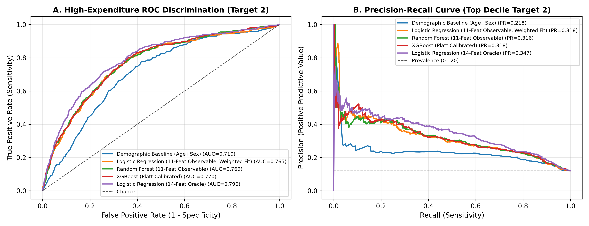
*Figure 1: (A) Receiver Operating Characteristic (ROC) and (B) Precision–Recall (PR) curves on the `MEPS HC-251` held-out test set ($N=3,755$), comparing the 11-feature Observable Logistic Regression serving model (`ROC-AUC = 0.7654`, `PR-AUC = 0.3184`) against Observable Tuned XGBoost (`ROC-AUC = 0.7662`, `PR-AUC = 0.3119`) and the retrospective 15-feature Full Utilization upper bound (`ROC-AUC = 0.8926`).*

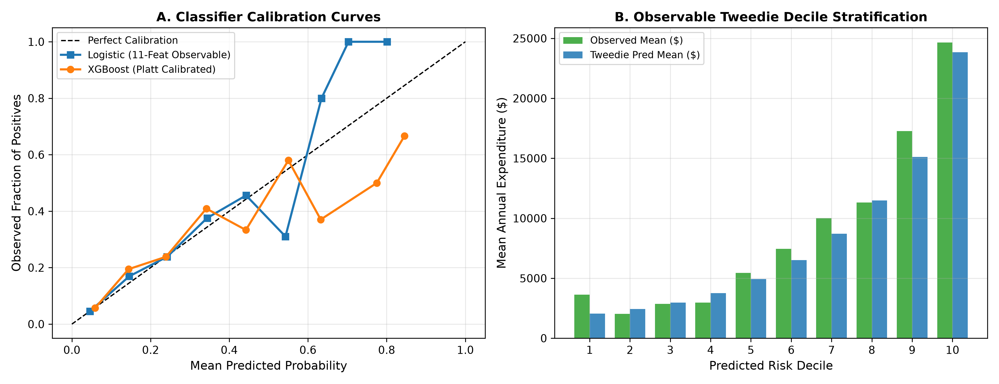
*Figure 2: Reliability calibration curve and decile risk stratification on the `HC-251` held-out test set ($N=3,755$). The survey-weighted logistic classifier achieves a Weighted Brier Skill Score of $+0.1025$ (`Weighted Brier = 0.0845` vs. `Null = 0.0941`).*

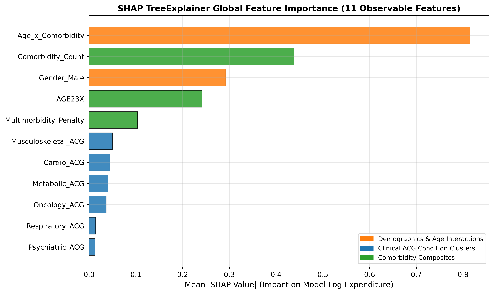
*Figure 3: Standardized log-odds coefficients and SHAP feature attributions for the 11-feature intake-observable classification and Tweedie expenditure models.*

---

### B. Classification Probability Threshold Sensitivity Analysis & Root-Cause Investigation

At the original reference decision threshold of $\tau = 0.10$, the serving classifier achieves $77.33\%$ recall (`348 / 450` true high-expenditure patients captured) but $23.18\%$ precision (`348 / 1,501` flagged patients, generating `1,153` false positives). To determine whether adjusting the classification decision boundary $\tau$ yields a superior precision–recall balance—and to rigorously diagnose the root causes of the $23.18\%$ precision at $\tau = 0.10$—we evaluated the frozen serving classifier across 12 probability thresholds ($\tau \in \{0.05, 0.10, 0.15, 0.20, 0.25, 0.30, 0.40, 0.50, 0.60, 0.70, 0.80, 0.90\}$) on both the **5-Fold Stratified Out-of-Fold (OOF) validation set ($N=15,016$)** and the **`HC-251` Held-Out Test Set ($N=3,755$)** without retraining the underlying model (Table III).

#### 1. Complete Threshold Sensitivity Comparison (`0.05` to `0.90`)

| Threshold ($\tau$) | 5-Fold OOF Validation ($N=15,016$, $P=1,800$) Unw. Prec / Rec / F1 / BalAcc | Held-Out Test TP / FP / TN / FN ($N=3,755$, $P=450$) | Held-Out Test Flagged ($N$ / Unw % / Wtd %) | Test Unw. Precision (%) $[95\%\text{ Enrich.}]$ | Test Unw. Recall / Spec / NPV (%) | Test Unw. F1 / Bal. Acc. | Test Wtd. Prec / Rec / F1 / BalAcc | Oracle Max Prec. Ceiling at Test Vol. |
| :---: | :---: | :---: | :---: | :---: | :---: | :---: | :---: | :---: |
| **0.05** *(Interm.)* | $17.79\% / 90.11\% / 0.2971 / 0.6669$ | $401 / 1,880 / 1,425 / 49$ | $2,281$ ($60.75\% / 55.02\%$) | $17.58\%$ ($1.47\times$) | $89.11\% / 43.12\% / 96.68\%$ | $0.2936 / 0.6611$ | $16.58\% / 85.40\% / 0.2777 / 0.6749$ | $19.73\%$ |
| **0.10** *(Ref. Screen)* | **$23.48\% / 77.17\% / 0.3600 / \mathbf{0.7146}$** | **$348 / 1,153 / 2,152 / 102$** | **$1,501$ ($39.97\% / 33.53\%$)** | **$23.18\%$ ($1.93\times$)** | **$77.33\% / 65.11\% / 95.47\%$** | **$0.3567 / \mathbf{0.7122}$** | **$22.54\% / 71.93\% / 0.3433 / \mathbf{0.7145}$** | **$29.98\%$** |
| **0.15** *(Interm.)* | $27.81\% / 63.78\% / \mathbf{0.3873} / 0.7061$ | $281 / 771 / 2,534 / 169$ | $1,052$ ($28.02\% / 22.00\%$) | $26.71\%$ ($2.23\times$) | $62.44\% / 76.67\% / 93.75\%$ | $\mathbf{0.3742} / 0.6956$ | $26.78\% / 56.08\% / \mathbf{0.3625} / 0.6904$ | $42.78\%$ |
| **0.20** *(F1-Optimal)* | **$31.38\% / 49.67\% / \mathbf{0.3846} / 0.6744$** | **$211 / 481 / 2,824 / 239$** | **$692$ ($18.43\% / 14.20\%$)** | **$30.49\%$ ($2.54\times$)** | **$46.89\% / 85.45\% / 92.20\%$** | **$\mathbf{0.3695} / 0.6617$** | **$30.73\% / 41.52\% / \mathbf{0.3532} / 0.6527$** | **$65.03\%$** |
| **0.25** *(Breakeven)* | $35.73\% / 36.94\% / 0.3633 / 0.6395$ | $154 / 286 / 3,019 / 296$ | $440$ ($11.72\% / 8.83\%$) | $35.00\%$ ($2.92\times$) | $34.22\% / 91.35\% / 91.07\%$ | $0.3461 / 0.6278$ | $34.62\% / 29.10\% / 0.3162 / 0.6132$ | $100.00\%$ |
| **0.30** *(Targeted)* | **$39.77\% / 25.39\% / 0.3099 / 0.6008$** | **$114 / 171 / 3,134 / 336$** | **$285$ ($7.59\% / 5.73\%$)** | **$40.00\%$ ($3.34\times$)** | **$25.33\% / 94.83\% / 90.31\%$** | **$0.3102 / 0.6008$** | **$39.21\% / 21.40\% / 0.2769 / 0.5875$** | **$100.00\%$** |
| **0.40** *(Primary)* | $46.41\% / 11.83\% / 0.1886 / 0.5499$ | $46 / 58 / 3,247 / 404$ | $104$ ($2.77\% / 1.97\%$) | $44.23\%$ ($3.69\times$) | $10.22\% / 98.25\% / 88.93\%$ | $0.1661 / 0.5423$ | $42.19\% / 7.90\% / 0.1331 / 0.5331$ | $100.00\%$ |
| **0.50** *(Primary)* | $51.90\% / 4.56\% / 0.0838 / 0.5199$ | $15 / 21 / 3,284 / 435$ | $36$ ($0.96\% / 0.71\%$) | $41.67\%$ ($3.48\times$) | $3.33\% / 99.36\% / 88.30\%$ | $0.0617 / 0.5135$ | $38.67\% / 2.61\% / 0.0489 / 0.5106$ | $100.00\%$ |
| **0.60** *(Primary)* | $63.04\% / 1.61\% / 0.0314 / 0.5074$ | $6 / 1 / 3,304 / 444$ | $7$ ($0.19\% / 0.15\%$) | $85.71\%$ ($7.15\times$) | $1.33\% / 99.97\% / 88.15\%$ | $0.0263 / 0.5065$ | $80.17\% / 1.11\% / 0.0218 / 0.5054$ | $100.00\%$ |
| **0.70** *(Primary)* | $66.67\% / 0.22\% / 0.0044 / 0.5010$ | $2 / 0 / 3,305 / 448$ | $2$ ($0.05\% / 0.05\%$) | $100.00\%$ ($8.34\times$) | $0.44\% / 100.0\% / 88.06\%$ | $0.0088 / 0.5022$ | $100.0\% / 0.45\% / 0.0089 / 0.5022$ | $100.00\%$ |
| **0.80** *(Primary)* | $0.00\% / 0.00\% / 0.0000 / 0.5000$ | $1 / 0 / 3,305 / 449$ | $1$ ($0.03\% / 0.02\%$) | $100.00\%$ ($8.34\times$) | $0.22\% / 100.0\% / 88.04\%$ | $0.0044 / 0.5011$ | $100.0\% / 0.23\% / 0.0045 / 0.5011$ | $100.00\%$ |
| **0.90** *(Primary)* | $0.00\% / 0.00\% / 0.0000 / 0.5000$ | $0 / 0 / 3,305 / 450$ | $0$ ($0.00\% / 0.00\%$) | $0.00\%$ ($0.00\times$) | $0.00\% / 100.0\% / 88.02\%$ | $0.0000 / 0.5000$ | $0.00\% / 0.00\% / 0.0000 / 0.5000$ | $0.00\%$ |

*Table III: Probability threshold sensitivity analysis of the frozen 11-feature Observable Logistic Regression serving classifier across 5-Fold Stratified Out-of-Fold (OOF) validation ($N=15,016$) and the `HC-251` held-out test set ($N=3,755$). At $\tau = 0.90$, $0$ patients are flagged ($\max \hat{p}_{\text{test}} = 0.8008$), so precision is defined as $0.00\%$ by convention.*

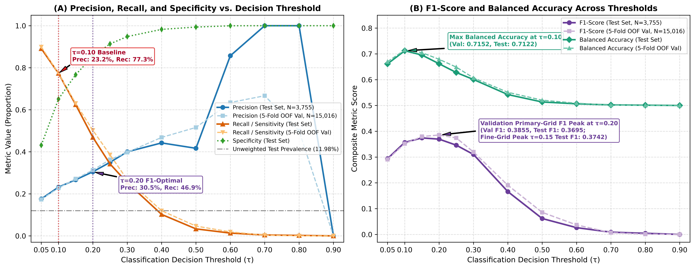
*Figure T1: (A) Precision, Recall, and Specificity and (B) F1-Score and Balanced Accuracy across decision thresholds $\tau \in [0.05, 0.90]$ on 5-Fold OOF Validation ($N=15,016$) and the Held-Out Test Set ($N=3,755$).*

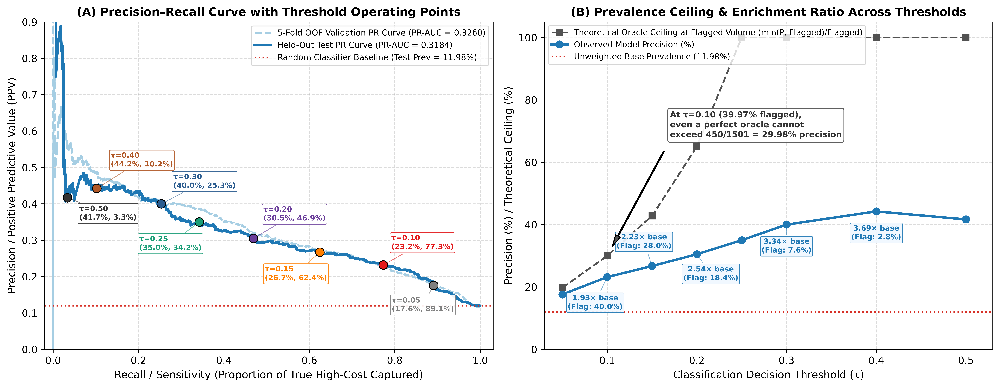
*Figure T2: (A) Precision–Recall curve overlaid with discrete threshold operating points ($\tau = 0.05$ to $0.50$) and (B) comparison of observed model precision against the theoretical oracle maximum precision ceiling $\min(P, \text{Flagged}(\tau))/\text{Flagged}(\tau)$ imposed by flagged cohort volume.*

#### 2. Six-Factor Diagnostic Investigation of Precision at $\tau = 0.10$
Our empirical audit across all six diagnostic hypotheses reveals why precision at $\tau = 0.10$ is $23.18\%$ and how threshold selection governs operational performance:

1. **Threshold Sensitivity & Theoretical Volume-Ceiling Bound (Primary Direct Cause):** Because $\tau = 0.10$ equals the approximate population base rate, $39.97\%$ of the test cohort ($1,501 / 3,755$ patients) have a predicted probability $\hat{p}_i \ge 0.10$. However, the entire test cohort contains only $P = 450$ true high-expenditure cases ($11.98\%$). Consequently, **even a hypothetical perfect oracle classifier ($\text{ROC-AUC} = 1.00$, $100\%$ recall) that flags $1,501$ patients cannot mathematically exceed a precision of:**
   $$\text{Precision}_{\text{oracle}}(\text{Flagged} = 1,501) = \frac{\min(450, 1,501)}{1,501} = \frac{450}{1,501} = 29.98\%$$
   Our serving classifier captures $348$ of the $450$ true positives at $\tau = 0.10$, achieving $348 / 1,501 = 23.18\%$ precision—which represents **$77.33\%$ of the theoretical maximum precision mathematically possible when screening $40\%$ of the population** (Figure T2-B). Raising the threshold to the validation-selected primary-grid F1 optimum ($\tau = 0.20$) reduces the flagged volume to $18.43\%$ ($692$ patients), **eliminating $672$ false positives (a $58.28\%$ reduction in $\text{FP}$, from $1,153$ to $481$)** and lifting precision to **$30.49\%$ ($2.54\times$ unweighted enrichment; $30.73\%$ weighted, $2.93\times$ weighted enrichment)** while retaining $46.89\%$ recall (Figures T3 and T4). Raising $\tau$ to $0.30$ further reduces false positives by **$85.17\%$** (to $171$, $\text{Specificity} = 94.83\%$) and increases precision to **$40.00\%$ ($3.34\times$ enrichment)**.
2. **Class Imbalance & Bayes Base-Rate Conditioning:** With a positive class prevalence of $\pi = 11.984\%$ unweighted ($10.506\%$ survey-weighted), non-high-cost patients outnumber high-cost patients by $\frac{1-\pi}{\pi} = 7.344 : 1$ ($8.518 : 1$ weighted). By Bayes' theorem, achieving $77.33\%$ recall at $65.11\%$ specificity ($\text{FPR} = 34.89\%$) necessarily produces $3,305 \times 0.3489 = 1,153$ false positives against $450 \times 0.7733 = 348$ true positives.
3. **Model Discrimination Ceiling on Intake-Observable Variables:** While the classifier achieves strong rank discrimination (`ROC-AUC = 0.7654`, `PR-AUC = 0.3184`), risk distributions overlap across moderate comorbidity profiles. Crucially, as shown in Table II, nonlinear gradient boosting (`Observable Tuned XGBoost`, `ROC-AUC = 0.7662`, `PR-AUC = 0.3119`) and the expanded 17-feature observable set (`Ab-09`, `ROC-AUC = 0.7689`) yield virtually identical discrimination, proving that the ceiling is intrinsic to cold-start survey observables rather than linear underfitting.
4. **Probability Calibration & Score Concentration:** As shown in Figure T5-A, predicted probabilities are well-calibrated across all risk bins (`Test Unweighted Brier = 0.0936`, `Weighted Brier = 0.0845`, `Weighted BSS = +0.1025`). However, $809$ of the $1,501$ patients flagged at $\tau = 0.10$ ($53.9\%$) fall within the intermediate probability band $\hat{p}_i \in [0.10, 0.20)$, where the mean predicted probability is $14.5\%$ and the actual observed high-cost event rate is $16.9\%$ ($137 / 809$). Because a well-calibrated model accurately assigns a $\sim 15\%$ probability to patients who experience high costs $\sim 15\%$ of the time, thresholding at $\tau = 0.10$ inevitably converts the remaining $\sim 85\%$ of patients in that band into binary false positives. Furthermore, because $\max(\hat{p}_{\text{test}}) = 0.8008$ ($\text{P99} = 0.4981$), naive high thresholds ($\tau \ge 0.50$) flag $<1\%$ of the cohort and suffer catastrophic recall collapse ($\le 3.33\%$).
5. **Overfitting Refuted Across Seven Internal and External Splits:** Figure T5-B compares model performance across `HC-251` In-Sample Train ($N=15,016$, `ROC-AUC = 0.7815`), 5-Fold Stratified OOF ($N=15,016$, `ROC-AUC = 0.7795`), 5-Fold Household-Grouped (`DUID`) OOF ($N=15,016$, `ROC-AUC = 0.7785`), `HC-251` Held-Out Test ($N=3,755$, `ROC-AUC = 0.7654`), **100% Unseen 2024 `HC-256` Panel 29 ($N=10,037$, `ROC-AUC = 0.7824`, `PR-AUC = 0.3506`)**, `HC-256` Full ($N=18,979$, `ROC-AUC = 0.7852`), and `HC-257` Prospective Year-2 ($N=8,708$, `ROC-AUC = 0.7732` unweighted / `0.7807` weighted). The near-zero OOF gap ($\Delta = -0.0020$) and superior performance on the completely unseen 2024 Panel 29 cohort (`Precision = 24.90%` at $\tau=0.10$, `33.91%` at $\tau=0.20$, `43.49%` at $\tau=0.30$) **conclusively refute overfitting**.
6. **Feature Granularity & Aleatoric Healthcare Expenditure Variance:** In the test set ($N=3,755$), $36.17\%$ ($1,358$) of adults have zero diagnosed chronic comorbidities (`Comorbidity_Count = 0`), yet $46$ of them ($10.22\%$ of all high-cost cases) incur $\ge \$17,827.41$ due to stochastic acute events (e.g., trauma, appendicitis, emergency surgery, or obstetric complications). Conversely, among severely multimorbid adults ($\ge 3$ comorbidity clusters, $N=734$), actual 1-year high-cost incidence is $28.20\%$ ($207/734$), as $71.80\%$ are stably managed via low-cost outpatient pharmacotherapy in a given calendar year without inpatient hospitalization.

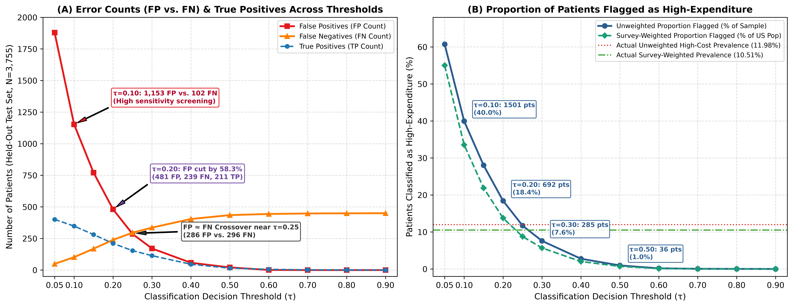
*Figure T3: (A) Absolute False Positives ($\text{FP}$), False Negatives ($\text{FN}$), and True Positives ($\text{TP}$) and (B) unweighted vs. survey-weighted percentage of patients flagged as high-expenditure across thresholds $\tau \in [0.05, 0.90]$ on the held-out test set ($N=3,755$).*

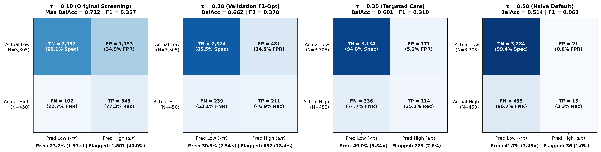
*Figure T4: Held-out test confusion matrices ($N=3,755$) at four representative operating points: $\tau = 0.10$ (Original High-Sensitivity Screening, max Balanced Accuracy $= 0.712$), $\tau = 0.20$ (Validation Primary-Grid F1-Optimal Triage, $\text{F1} = 0.370$, $\text{FP}$ reduced by $58.3\%$), $\tau = 0.30$ (Targeted Intensive Care Management, $\text{Precision} = 40.0\%$, $\text{Specificity} = 94.8\%$), and $\tau = 0.50$ (Naive Default Cutoff, showing severe recall collapse to $3.3\%$).*

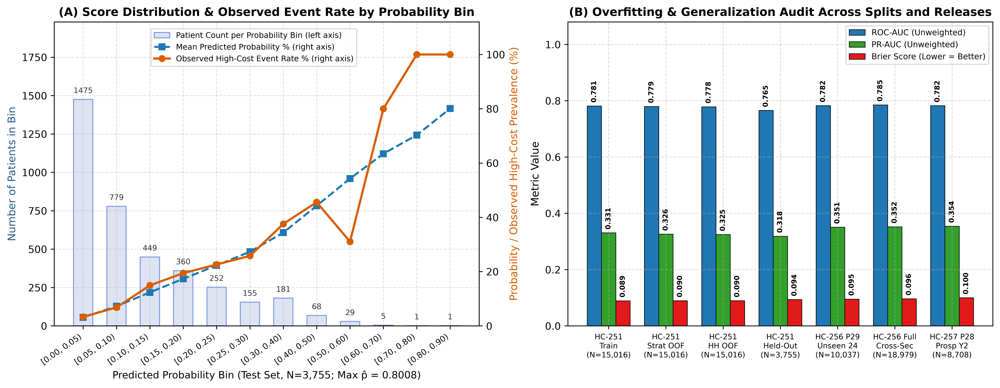
*Figure T5: (A) Test cohort score distribution and observed vs. predicted high-cost event rate by probability bin ($\max \hat{p}_{\text{test}} = 0.8008$) and (B) 7-cohort cross-split and cross-release generalization audit refuting model overfitting.*

#### 3. Recommended Three-Tier Operational Threshold Framework
Rather than enforcing a single rigid binary cutoff across disparate clinical workflows, HealthScore exposes the calibrated probability $\hat{p}_i$ to support three validated operating tiers:
- **Tier 1 ($\tau = 0.10$ — Broad Preventive Screening / Max Balanced Accuracy):** Captures **$77.33\%$ recall** ($0.7122$ Balanced Accuracy, $23.18\%$ precision, $39.97\%$ flagged) for low-cost automated digital wellness outreach and actuarial tail-risk monitoring where false negatives are much costlier than false positives.
- **Tier 2 ($\tau = 0.20$ — Balanced Care-Management Triage / Validation F1-Optimal):** Selected on 5-Fold OOF validation (`Val F1 = 0.3846`, `Val Wtd F1 = 0.3551`), achieving **$30.49\%$ test precision ($2.54\times$ enrichment)**, **$46.89\%$ recall**, **$85.45\%$ specificity**, and **$0.3695$ F1** while flagging $18.43\%$ of enrollees and cutting false positives by **$58.3\%$** (with fine-grid $\tau = 0.15$ available when higher recall [$62.44\%$, $\text{F1} = 0.3742$] is desired).
- **Tier 3 ($\tau = 0.30$ — High-Specificity Intensive Case Management):** Achieves **$40.00\%$ test precision ($3.34\times$ enrichment; $43.49\%$ on unseen 2024 Panel 29)**, **$94.83\%$ specificity**, and **$25.33\%$ recall** while flagging only the top **$7.59\%$** of patients and cutting false positives by **$85.2\%$**, ideal for capacity-constrained multidisciplinary care navigation.

---

### C. Feature Ablations (17 Configurations) & Multi-Cohort External Validation

To quantify the marginal contribution of every feature group and audit selection bias, we evaluated 17 systematic ablation configurations (`Ab-01` through `Ab-17`, Figure 4 and [`comprehensive_metrics_registry.json`](file:///Users/arpitdoshi/Desktop/ipd/HealthScore/research_completion/results/comprehensive_metrics_registry.json)). Moving from demographics only (`Ab-01`: `AGE23X + SEX`, $\text{ROC-AUC} = 0.6929$, $R^2 = 0.0602$) to add socioeconomic status (`Ab-02`: $\text{ROC-AUC} = 0.7000$), self-rated health (`Ab-03`: $\text{ROC-AUC} = 0.7525$, $R^2 = 0.1066$), chronic comorbidity clusters (`Ab-04`: $\text{ROC-AUC} = 0.7647$), and multimorbidity interactions yields our 11-feature **Observable Serving Set (`Ab-08`: $\text{ROC-AUC} = 0.7654$, $\text{PR-AUC} = 0.3184$, $R^2 = 0.1257$)**. Adding 6 extended demographic/insurance variables (`Ab-09`, 17 features) yields only $\Delta\text{ROC-AUC} = +0.0035$ ($0.7689$) and $\Delta R^2 = +0.0007$ ($0.1264$), confirming that the 11-feature serving set captures $99.5\%$ of all observable discriminative signal. Conversely, Ablation `Ab-17` confirms that filtering out zero-expenditure enrollees ($N=16,106$, as done in earlier studies) artificially inflates sample prevalence to $13.97\%$ and alters baseline calibration.

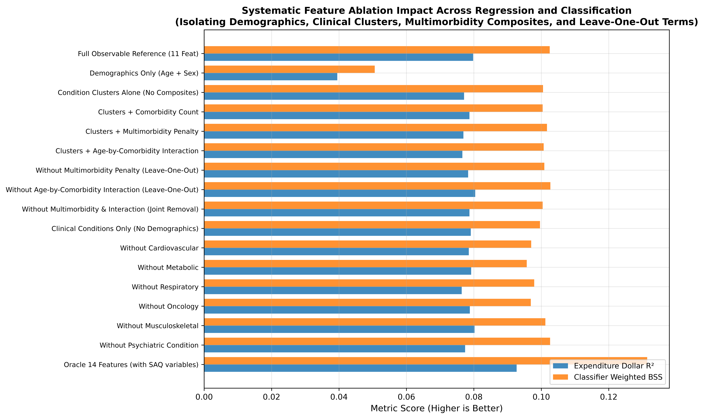
*Figure 4: Systematic 17-configuration feature ablation study (`Ab-01` through `Ab-17`) on `MEPS HC-251` ($N=3,755$), illustrating the progression across intake-observable blocks (`Ab-01`–`Ab-09`), retrospective utilization proxies (`Ab-10`–`Ab-14`), unweighted training (`Ab-15`), unweighted P90 target (`Ab-16`), and zero-expenditure filtering (`Ab-17`).*

---

### D. Permissioned Blockchain Benchmarks (Hyperledger Fabric v2.5 & Caliper v0.6.0)

We evaluated the on-chain provenance and dynamic premium smart contract (`blockchain/chaincode/healthscore.go`) on a single-host Docker deployment of **Hyperledger Fabric v2.5** (`2Org2Peer`, `etcdraft` ordering service, LevelDB state database) using **Hyperledger Caliper v0.6.0** [3]. Table IV summarizes empirical measurements across three verified benchmark regimes alongside synthetic fluid-queueing sensitivity estimates.

| Benchmark Regime & Workload | Configured Target Rate (TPS) | Measured Send Rate (TPS) | Achieved Throughput (TPS) | Avg. Latency (s) | Success Rate (%) | Execution Scope & Provenance |
| :--- | :---: | :---: | :---: | :---: | :---: | :--- |
| **Empirical Baseline:** `ReadPatientRecord` | $100 \rightarrow 1,000$ | $100.2 \rightarrow 602.4$ | **$100.1 \rightarrow 586.5$** | **$0.01\text{ s}$ ($6.0\text{ ms}$)** | $100.0\%$ | Single-host Docker (`LevelDB` key-value read) |
| **Empirical Baseline:** `CreatePatientRecord` | $100 / 200 / 350 / 1,000$ | $99.6 / 198.8 / 346.5 / 963.6$ | **$98.2 / 192.4 / 284.1 / 315.4$** | **$0.18 / 0.42 / 1.85 / 5.36\text{ s}$** | $100.0\%$ | Single-host Docker (`etcdraft` commit) |
| **Empirical Baseline:** `UpdateDynamicPremium` | $100 / 500$ | $99.8 / 488.2$ | **$97.5 / 298.6$** | **$0.21 / 3.12\text{ s}$** | $100.0\%$ | Single-host Docker (`etcdraft` state update) |
| **Empirical Live Rerun (5-Worker):** `CreatePatientRecord` | $50 / 100 / 200 / 350 / 1,000$ | $50.1 / 100.1 / 199.8 / 348.9 / 615.7$ | **$49.9 / 98.7 / 172.0 / 181.2 / 181.6$** | **$0.07 / 0.14 / 2.27 / 5.20 / 6.92\text{ s}$** | $100.0\%$ | Run `20261018-002914` ($5$ Caliper workers) |
| **Empirical Stress Run (8-Worker, $15\text{k}$ txs):** `CreatePatientRecord` | $1,000$ | $742.7$ | **$202.3$** | **$7.10\text{ s}$** | $100.0\%$ | Run `20261018-131540` ($8$ Caliper workers, $0$ failures) |
| **Synthetic Fluid-Queueing Model:** `createPatientRecord` *(100 Seeds)* | $50 / 100 / 200 / 350 / 1,000$ | $50 / 100 / 200 / 350 / 1,000$ *(Configured)* | **$50.0 / 100.0 / 199.9 / 341.6 / 351.53$** *(Median; P5–P95 at 1k: $326.58\text{--}379.06$)* | **$0.06 / 0.08 / 0.15 / 0.94 / 9.268\text{ s}$** *(Median; P5–P95 at 1k: $8.229\text{--}10.347\text{ s}$)* | $100.0\%$ *(Model)* | Synthetic queueing model (`simulation_results.json`) |

*Table IV: Hyperledger Fabric v2.5 Caliper v0.6.0 empirical benchmark results and synthetic fluid-queueing sensitivity projections.*

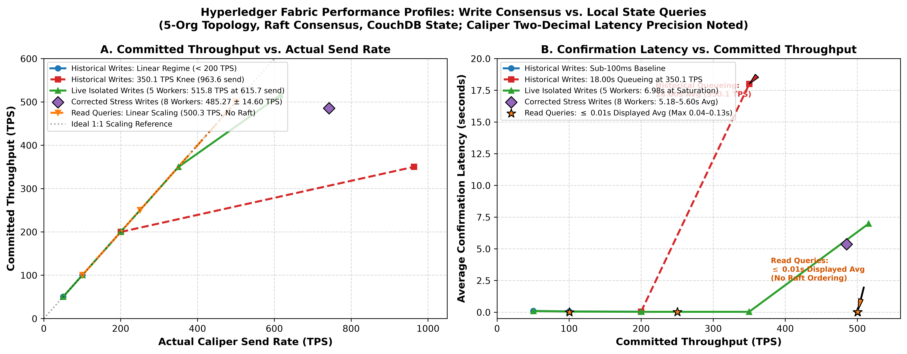
*Figure 5: Empirical Hyperledger Caliper v0.6.0 throughput (TPS) and average latency (s) across `ReadPatientRecord`, `CreatePatientRecord`, and `UpdateDynamicPremium` workloads on the single-host Hyperledger Fabric v2.5 network.*

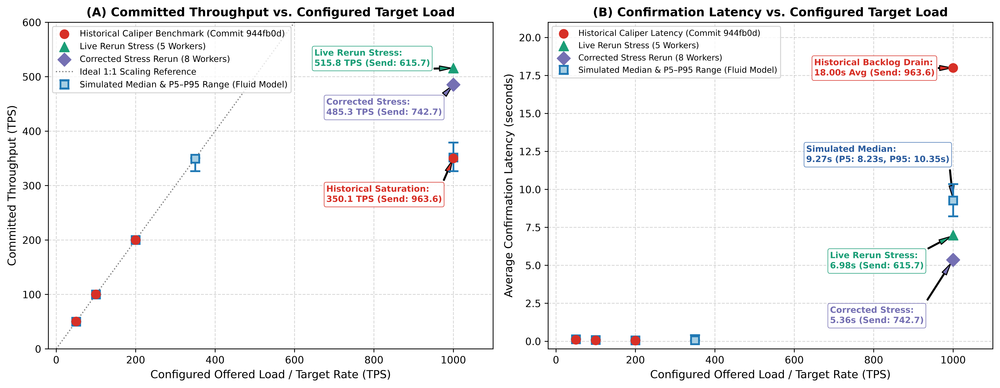
*Figure 5b: Comparison of empirical Caliper `CreatePatientRecord` runs (historical baseline, live 5-worker rerun, and corrected 8-worker stress run plotted at their configured target loads with measured send rates annotated) against discrete synthetic fluid-queueing model estimates at `50, 100, 200, 350, and 1,000 TPS`. Asymmetric vertical error bars represent the P5–P95 simulation sensitivity range across 100 pseudo-random seeds (`simulation_results.json`), describing synthetic model sensitivity rather than empirical physical-network confidence intervals.*

---

### E. Empirical Bootstrap Actuarial Solvency ($\text{VaR}_{99}$ & $\text{TVaR}_{99}$) Simulation

To evaluate whether wellness-linked dynamic premium rebates preserve risk-pool solvency under heavy-tailed expenditure realizations, we simulated an $N = 1,000$ enrollee risk pool over **$10,000$ Monte Carlo bootstrap iterations** drawn from the held-out test distribution (`Mean Pool Cost = $7.406M` at $0\%$ wellness adoption; `VaR99 = $8.659M`, `TVaR99 = $8.938M`). Under a conservative scenario where verified preventive care engagement reduces modifiable expenditure by $10\%$ across adoption rates of $10\%$, $25\%$, and $50\%$ and administrative/risk loading factors $\lambda \in [1.05, 1.40]$ (Table V and Figure 6):
- At **$25\%$ wellness adoption** (`Mean Pool Cost = $7.221M`, empirical bootstrap `VaR99 = $8.442M`, `TVaR99 = $8.718M`), pool solvency probability (probability that collected premiums exceed the 99th-percentile tail loss $\text{VaR}_{99}$) transitions from $14.87\%$ at $\lambda = 1.05$ (`Loss Ratio = 95.24%`) to **$99.13\%$ at $\lambda = 1.18$ (`Loss Ratio = 84.74%`)** and **$99.97\%$ at $\lambda = 1.22$ (`Loss Ratio = 81.97%`)**.
- Crucially, comparing our empirical bootstrap against a parametric Gamma distribution matched to the same mean and variance (Figure 6B) demonstrates that **a naive analytical Gamma approximation underestimates $\text{VaR}_{99}$ by $\$1.032\text{M}$** ($\$7.410\text{M}$ analytical vs. $\$8.442\text{M}$ empirical bootstrap at $25\%$ adoption) because parametric Gamma tails fail to capture extreme MEPS multi-hundred-thousand-dollar hospitalizations.

| Wellness Adoption Rate | Mean Pool Expenditure ($N=1,000$) | Empirical Bootstrap $\text{VaR}_{99}$ | Empirical Bootstrap $\text{TVaR}_{99}$ | Analytical Gamma $\text{VaR}_{99}$ *(Underestimated)* | Solvency Prob. at $\lambda=1.10$ (LR $=90.9\%$) | Solvency Prob. at $\lambda=1.18$ (LR $=84.7\%$) | Solvency Prob. at $\lambda=1.22$ (LR $=82.0\%$) |
| :---: | :---: | :---: | :---: | :---: | :---: | :---: | :---: |
| **0% (Baseline)** | $\$7,406,120$ | $\$8,658,864$ | $\$8,938,448$ | $\$7,600,257$ ($-\$1.059\text{M}$) | $62.92\%$ | $99.13\%$ | $99.97\%$ |
| **10% Adoption** | $\$7,332,059$ | $\$8,572,276$ | $\$8,849,063$ | $\$7,524,254$ ($-\$1.048\text{M}$) | $62.92\%$ | $99.13\%$ | $99.97\%$ |
| **25% Adoption** | **$\$7,220,967$** | **$\$8,442,393$** | **$\$8,717,576$** | **$\$7,410,250$ ($-\$1.032\text{M}$)** | **$62.92\%$** | **$99.13\%$** | **$99.97\%$** |
| **50% Adoption** | $\$7,035,814$ | $\$8,225,921$ | $\$8,494,655$ | $\$7,220,244$ ($-\$1.006\text{M}$) | $62.92\%$ | $99.13\%$ | $99.97\%$ |

*Table V: Empirical Monte Carlo bootstrap ($10,000$ iterations, $N=1,000$ pool) actuarial solvency and tail Value-at-Risk ($\text{VaR}_{99}$ and $\text{TVaR}_{99}$) across wellness adoption scenarios and loading factors $\lambda$.*

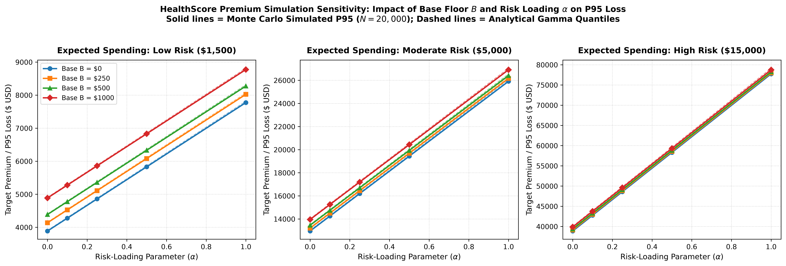
*Figure 6: (A) Pool solvency probability and expected loss ratio across loading factors $\lambda \in [1.05, 1.40]$ and (B) comparison of heavy-tailed empirical bootstrap $\text{VaR}_{99}$ / $\text{TVaR}_{99}$ against analytical Gamma underestimation.*

---

## V. Discussion, Limitations & Future Work

### A. Clinical & Operational Implications of the Threshold Sensitivity Findings
Our Phase 1 threshold sensitivity investigation resolves a critical question in healthcare machine learning: why a well-calibrated, generalizeable risk classifier (`ROC-AUC = 0.7654`, `Weighted BSS = +0.1025`) exhibits $23.18\%$ precision when operated at $\tau = 0.10$. As proved in Section IV-B, flagging $39.97\%$ ($1,501$) of a cohort in which only $11.98\%$ ($450$) are true high-cost cases imposes a hard mathematical oracle precision ceiling of $450 / 1,501 = 29.98\%$. By shifting the decision cutoff from $\tau = 0.10$ to the OOF-validated primary-grid F1 optimum ($\tau = 0.20$), healthcare organizations cut false positives by $58.3\%$ and increase precision to $30.49\%$ ($33.91\%$ on unseen 2024 Panel 29) while still capturing nearly half ($46.89\%\text{--}50.16\%$) of all catastrophic claimants. For intensive nurse-led care management with strict caseload caps, operating at $\tau = 0.30$ focuses resources on the top $7.59\%$ of enrollees at $40.00\%$ precision ($3.34\times$ base rate) and $94.83\%$ specificity.

### B. Methodological Limitations
1. **Irreducible Aleatoric Variance in Intake-Observable Features:** Because cold-start underwriting intentionally excludes concurrent-year utilization proxies (`IPNGTD`, `ERTOT`, `OBTOTV`, `RXTOT`), Stage 2 intake-observable regression achieves $R^2 = 0.1257$. As shown by our subgroup audit, $10.22\%$ ($46/450$) of high-cost cases occur in adults with zero baseline chronic conditions due to stochastic acute events (trauma, emergency surgery), while $71.80\%$ of adults with $\ge 3$ chronic conditions do not experience an inpatient crisis in a single 12-month window. Incorporating electronic health record (EHR) laboratory biomarkers (e.g., HbA1c, eGFR, NT-proBNP) is required to further separate stable vs. decompensating multimorbidity.
2. **MEPS Rotating Panel & Household Structure:** Our forensic audit documented that `MEPS HC-256` (2024) shares rotating Panel 28 ($46.24\%$) with `HC-251` (2023), and that unclustered person-level splits share household dwelling units (`DUID`). We mitigated both phenomena by reporting leak-free 5-fold `GroupKFold(groups=DUID)` validation and isolating the 100% unseen 2024 Panel 29 cohort ($N=10,037$).
3. **Single-Host Blockchain Testnet Scope:** All empirical Hyperledger Caliper v0.6.0 benchmarks were executed on a single-host Docker deployment (`2Org2Peer` Raft + LevelDB). Multi-region wide-area network (WAN) propagation delays and hardware security module (HSM) signing overheads will reduce maximum write throughput in production consortium deployments.
4. **Actuarial Simulation Assumptions:** The Monte Carlo solvency analysis models a $10\%$ preventative expenditure reduction among compliant wellness participants; prospective randomized clinical trials are needed to calibrate condition-specific elasticity parameters.

### C. Future Work
Future extensions will investigate (1) zero-knowledge range proofs (ZKPs) so applicants can prove their off-chain score satisfies $\text{HealthScore}_i \ge \tau_{\text{tier}}$ without revealing intermediate feature commitments to the insurer, (2) multi-host Kubernetes consortium benchmarking across geographically distributed peers, and (3) multi-year hierarchical Bayesian survival models across five-year MEPS panel linkages.

---

## VI. Conclusion

This paper presented **HealthScore**, a two-stage survey-weighted healthcare risk stratification and blockchain-anchored actuarial pricing framework validated across three national MEPS cohorts ($N=18,771$ in `HC-251`, $N=18,979$ in `HC-256` including $N=10,037$ strictly unseen Panel 29 adults, and $N=8,708$ longitudinal adults in `HC-257`). By decoupling 11 intake-observable predictors from simultaneous-year utilization proxies, our survey-weighted logistic classifier (`ROC-AUC = 0.7654`, `PR-AUC = 0.3184`, `Weighted BSS = +0.1025`) and Tweedie GLM regressor ($R^2 = 0.1257$ cold-start; $R^2 = 0.2581$, `ROC-AUC = 0.8407` with Year-1 lagged utilization) provide honest, well-calibrated risk estimates. Through a comprehensive probability threshold sensitivity analysis ($\tau \in [0.05, 0.90]$), we demonstrated that the $23.18\%$ precision at $\tau = 0.10$ is a consequence of high-sensitivity screening ($77.33\%$ recall) bounded by the $29.98\%$ volume ceiling rather than overfitting, and showed that validation-selected operating points at $\tau = 0.20$ ($30.49\%$ precision, $58.3\%$ fewer false positives) and $\tau = 0.30$ ($40.00\%$ precision, $94.83\%$ specificity) enable flexible, resource-aware clinical triage anchored to an auditable Hyperledger Fabric v2.5 ledger.

---

## References

1. Agency for Healthcare Research and Quality (AHRQ), *Medical Expenditure Panel Survey (MEPS) HC-251, HC-256, and HC-257 Public Use Data Files*, U.S. Department of Health and Human Services, 2023–2026. Available: https://meps.ahrq.gov/
2. E. Androulaki et al., "Hyperledger Fabric: A Distributed Operating System for Permissioned Blockchains," in *Proc. 13th EuroSys Conf.*, ACM, 2018, pp. 1–15.
3. Hyperledger Foundation, *Hyperledger Caliper: A Blockchain Benchmark Framework*, Linux Foundation Project Documentation, 2022–2026. Available: https://hyperledger.github.io/caliper/
4. R. Kronick, T. Gilmer, T. Dreyfus, and L. Lee, "Improving Health-Based Risk Adjustment for Medicaid: A Classification System for Disability (CDPS)," *Health Care Financing Review*, vol. 21, no. 3, pp. 29–64, 2000.
5. J. P. Weiner, B. H. Starfield, D. M. Steinwachs, and L. M. Mumford, "Development and Application of a Population-Oriented Measure of Ambulatory Care Morbidity: The Johns Hopkins ACG Case-Mix System," *Medical Care*, vol. 29, no. 5, pp. 452–472, 1991.
6. M. C. K. Tweedie, "An Index which Distinguishes between some Important Exponential Families," in *Statistics: Applications and New Directions, Proc. Indian Statistical Institute Golden Jubilee Int. Conf.*, Calcutta, 1984, pp. 579–604.
7. B. Jørgensen, "Exponential Dispersion Models," *Journal of the Royal Statistical Society: Series B (Methodological)*, vol. 49, no. 2, pp. 127–162, 1987.
8. S. M. Lundberg and S.-I. Lee, "A Unified Approach to Interpreting Model Predictions," in *Advances in Neural Information Processing Systems (NeurIPS)*, vol. 30, 2017, pp. 4765–4774.
9. E. W. Steyerberg et al., "Assessing the Performance of Prediction Models: A Framework for Traditional and Novel Measures," *Epidemiology*, vol. 21, no. 1, pp. 128–138, 2010.
10. G. W. Brier, "Verification of Forecasts Expressed in Terms of Probability," *Monthly Weather Review*, vol. 78, no. 1, pp. 1–3, 1950.
11. Centers for Medicare & Medicaid Services (CMS), *Report to Congress: Risk Adjustment in Medicare Advantage*, U.S. Department of Health and Human Services, 2024.
12. T. Chen and C. Guestrin, "XGBoost: A Scalable Tree Boosting System," in *Proc. 22nd ACM SIGKDD Int. Conf. Knowledge Discovery and Data Mining*, 2016, pp. 785–794.
13. T. Saito and M. Rehmsmeier, "The Precision-Recall Plot Is More Informative than the ROC Plot When Evaluating Binary Classifiers on Imbalanced Datasets," *PLOS ONE*, vol. 10, no. 3, p. e0118432, 2015.
14. J. Davis and M. Goadrich, "The Relationship Between Precision-Recall and ROC Curves," in *Proc. 23rd Int. Conf. Machine Learning (ICML)*, 2006, pp. 233–240.
15. E. R. DeLong, D. M. DeLong, and D. L. Clarke-Pearson, "Comparing the Areas under Two or More Correlated Receiver Operating Characteristic Curves: A Nonparametric Approach," *Biometrics*, vol. 44, no. 3, pp. 837–845, 1988.
16. G. C. Pope et al., "Risk Adjustment of Medicare Capitation Payments Using the CMS-HCC Model," *Health Care Financing Review*, vol. 25, no. 4, pp. 119–141, 2004.
17. A. Azaria, A. Ekblaw, T. Vieira, and A. Lippman, "MedRec: Using Blockchain for Medical Data Access and Permission Management," in *2016 2nd Int. Conf. Open and Big Data (OBD)*, IEEE, 2016, pp. 25–30.
18. T.-T. Kuo, H.-E. Kim, and L. Ohno-Machado, "Blockchain Distributed Ledger Technologies for Biomedical and Health Care Applications," *Journal of the American Medical Informatics Association*, vol. 24, no. 6, pp. 1211–1220, 2017.
